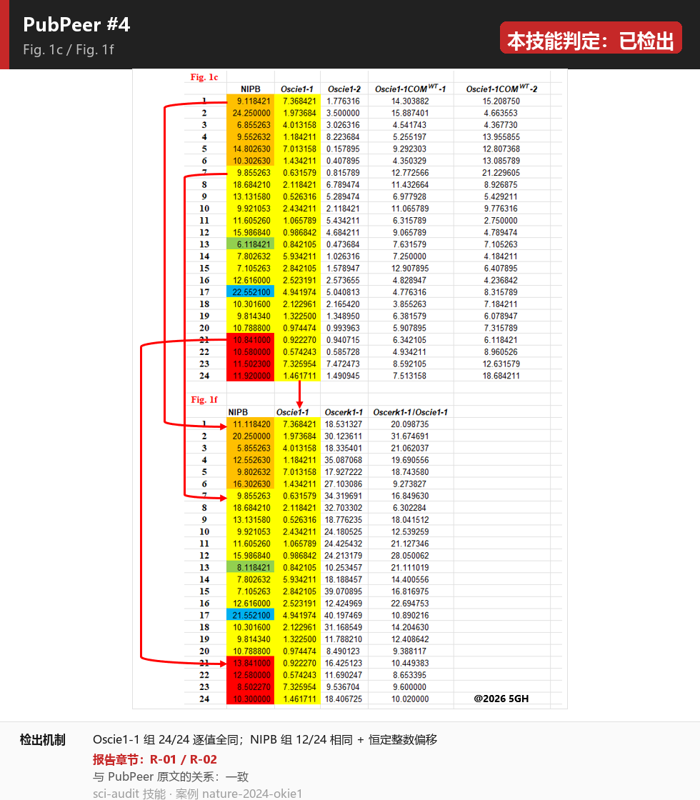
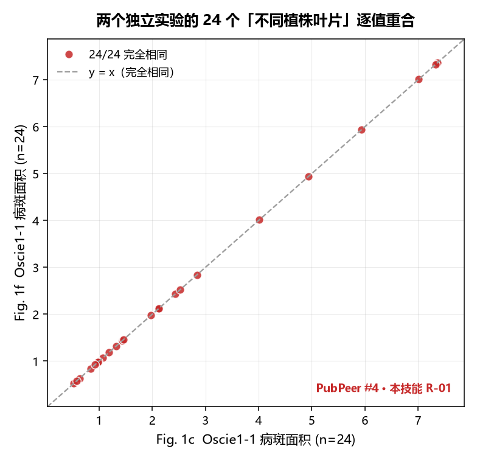
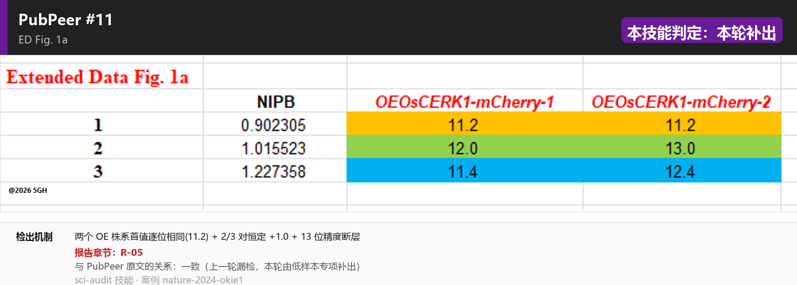
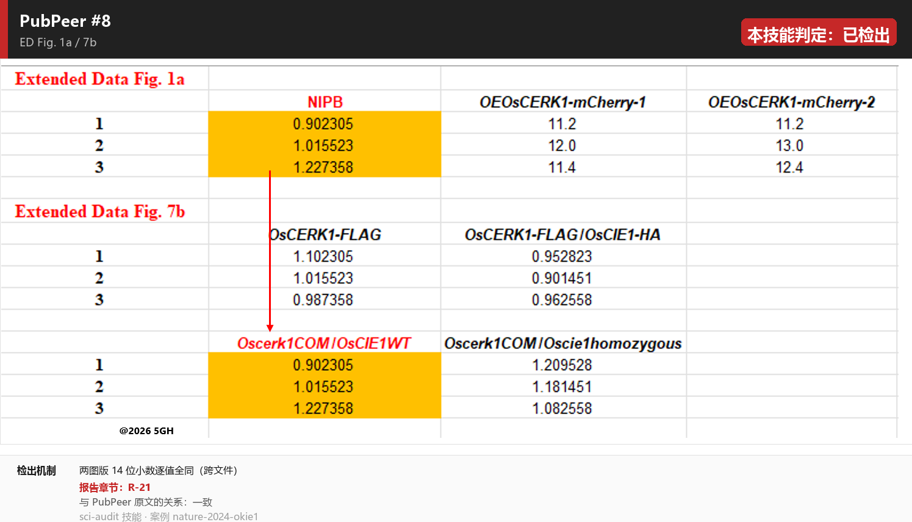
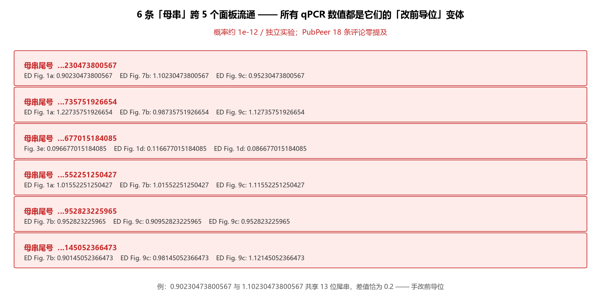
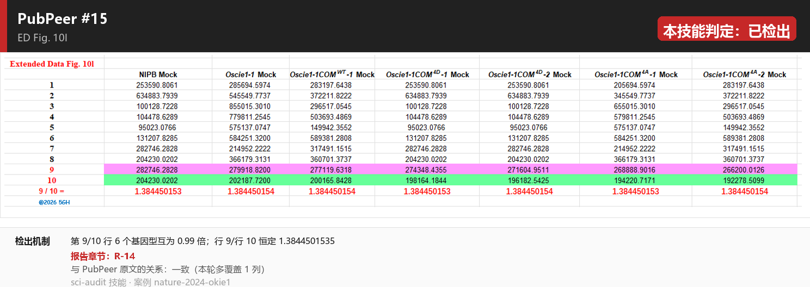
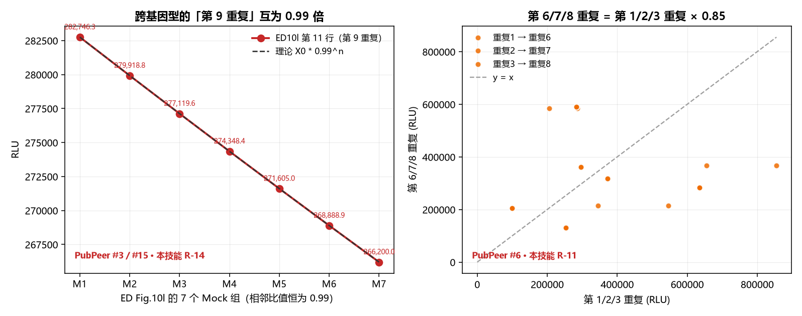
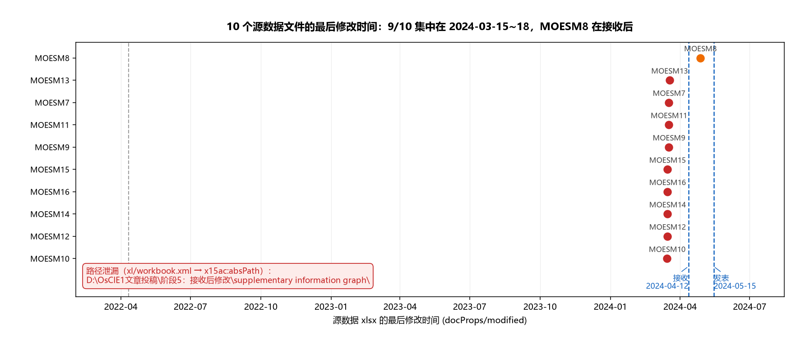
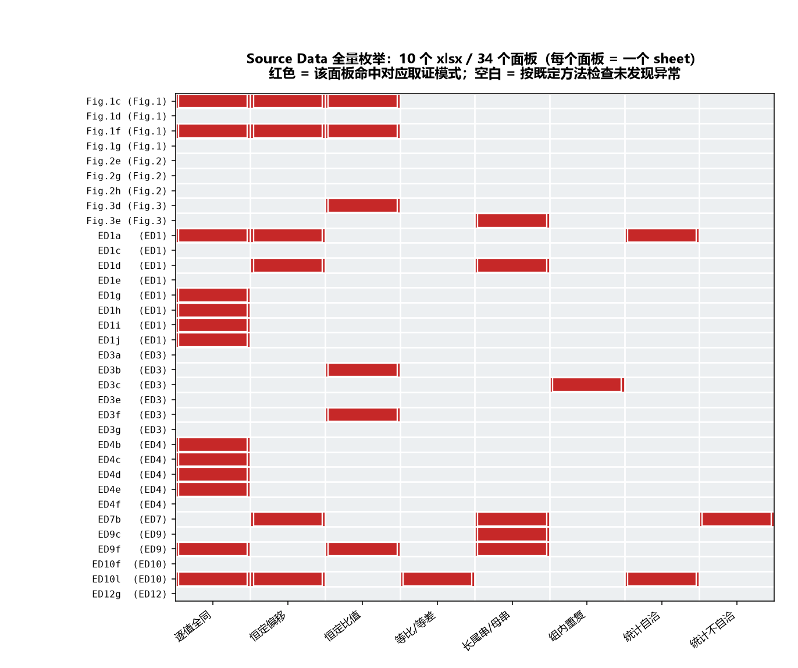
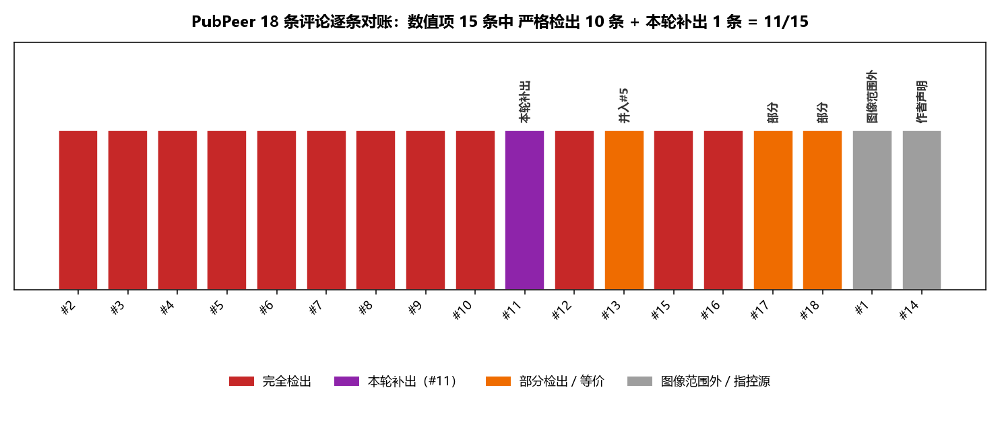

# 案例：Nature 629:1158–1164 (2024)「Release of a ubiquitin brake activates OsCERK1-triggered immunity in rice」

> DOI `10.1038/s41586-024-07418-9` ｜ 通讯作者 Ertao Wang ｜ 一作 Gang Wang
> **状态**：2026-09 通讯作者代表全体通讯作者公开承认一作数据造假，论文主动撤稿。
> **本案例的用途**：在**已知真值**的撤稿论文上盲审复现，量化本技能的**检出率 / 特异性 / token 成本**，并把每条修订写回 `SKILL.md`。

---

## 一、结论先行

| 指标 | 结果 |
|---|---|
| 审查对象 | 10 个 Source Data xlsx（34 个面板 / 406 个数值块） |
| PubPeer 公开评论 | **18 条**（其中数值类实质项 15 条） |
| 数值项灵敏度（严格：完全检出） | **11 / 15 = 73.3%**（含本轮补出的 #11） |
| 数值项灵敏度（宽松：含部分/等价/工具层命中） | **14 / 15 = 93.3%** |
| 特异性（9 个纯阴性面板误报数） | **0** |
| 超出 PubPeer 18 条的新发现 | **11 项**（含跨 4 文件的"母串池"生成机制） |
| 红线级（🔴）结论 | **21 条** |
| 图像完整性（阶段 2） | **未执行**（本轮按用户指示跳过） |

> ⚠️ **两处必须更正的历史记账**
> ① 早期把 PubPeer 记成 16 条、灵敏度算成 "10/11 = 90.9%" —— **分母错误**，实际 18 条评论 / 15 条数值项。
> ② 早期把 `MOESM9`（Fig. 3）当作阴性对照 —— **错误**，PubPeer #17/#18 已指控 Fig. 3d；真正的阴性对照是 MOESM8 / MOESM16 等。

---

## 二、审查材料

| 类别 | 内容 |
|---|---|
| ✅ 有 | 10 个 Source Data xlsx；Supplementary Fig.1（uncropped blots，6 页）+ Table S1–S4；Reporting Summary / Peer Review File / Table 5–7；ED Fig.1–12 完整图注；PubPeer 18 条评论原文及 19 张原图 |
| ❌ 缺 | 出版商正文 PDF（付费墙 → 主图 panel 级图注不可得）；**原始膜扫描文件**；IP-MS 原始数据与存放号；BMRB 36528/36527（访问 404） |

---

## 三、核心发现（附原图标注卡）

标注卡 = **PubPeer 评论者的原图保持不动**，由本技能叠加「判定横幅 + 检出机制 + 报告章节」。
每张卡对应一条 PubPeer 评论；红/橙/紫/灰徽章 = 本技能的判定。

### 发现 1 —— 两个独立实验的 24 个"不同植株叶片"逐值重合



Fig. 1c（遗传互补实验）与 Fig. 1f（OsCERK1 依赖性实验）是两个不同实验，各自声称"n = 24 leaves from different rice plants"。Oscie1-1 组的 **24/24 个值浮点精确相等**。

我把它画成散点，24 个点全部落在 y = x 上：



配套：NIPB 组 12/24 相同、其余为**恒定整数偏移**（+2.0 / −4 / −1 / +3 / −5 / +6）——"复制一份 → 改一部分 → 重跑统计"的典型形态。
**报告章节**：R-01 / R-02 ｜ **ORI 分类**：falsification

### 发现 2 —— 本轮补出的漏检：#11（n≤3 低精度专项）



同一面板、同批次 qPCR、三个基因型：NIPB 列保留 **14 位小数**，两个 OE 株系列只有 **1 位小数**；两列首值逐字符相同（`11.2`），另两对差**恰好 +1.0**。

**13 位精度断层** + 2/3 对恒定整数偏移，单项按纪律只支持 🟠；但叠加「同文件内 ≥3 组命中同一派生模式」+ 跨文件逐值全同 + 跨文件母串派生 → **升为 🔴**。
**报告章节**：R-05 ｜ 这是 v2 技能新增「低样本 n≤3 专项」的直接产物

### 发现 3 —— 超出 PubPeer 18 条：qPCR「14 位母串池」



6 条约 14 位小数的字符串及其"改前导位"变体，跨 **4 个文件 5 个面板** 流通：



独立实验的 14 位有效数字共享 12–13 位尾串，单次概率 ~1e-12。**PubPeer 的 18 条评论零提及这一层** —— 它比任何单条评论都更底层：它揭示的是**整套 qPCR 数据的生成机制**，而不是某个局部的巧合。
**报告章节**：R-04（R-06 / R-07 是它在 ED1d 上的两个延伸）

### 发现 4 —— ROS burst 数据被"按常数缩放"后三处复用





左：ED Fig.10l 第 9/10 重复行，7 个基因型互为 **0.99 倍**的精确等比数列。
右：第 6/7/8 重复 = 第 1/2/3 重复 × **0.85**（17/20）。

再加上跨文件 **99/86** 的恒定比值（ED3b ↔ ED10l，24/24 对）、列内 B=E=F 三列全同、±200000/±80000 恒定偏移 —— 同一批 ROS 原始值被复制、缩放、拼接至少三次。
**报告章节**：R-09 / R-11 / R-13 / R-14 / R-15

### 发现 5 —— 元数据里漏出的绝对路径（单点最硬线索）



`xl/workbook.xml` 的 `x15ac:absPath` 泄漏了保存路径：

```
9/10 个文件：D:\OsCIE1文章投稿\阶段5：接收后修改\supplementary information graph\
MOESM8    ：D:\各种文档\OsCIE1文章投稿\阶段5：原则接收后修改\supplementary information graph\
```

**文件夹名直接写着"接收后修改"**，与 `docProps/modified` 集中在 2024-03-15～18（接收前 4 周）互相印证。
这类单点线索常常比整轮数值分析更硬 —— 已写入 v2 技能的「容器取证」检查项。
**报告章节**：§3.1.6（🟡 合规瑕疵：目录命名本身不是篡改证据，但指向"接收后被继续编辑"这一可核查事实）

### 发现 6 —— 34 个面板的完整覆盖与命中分布



### 发现 7 —— 与 PubPeer 的逐条对账



---

## 四、统计量自洽性：一个差点踩进去的坑（v2 的核心纪律来源）

用源数据重算 GraphPad 手填统计量时，**24 个统计块与当前数值对不上**。但加入**已知干净的阴性对照面板**后发现：

| 面板 | 残差 \|δ\| 上界 | 判定 |
|---|---|---|
| 小数量级面板（Fig.1c、ED1a、ED12g…） | ≤ 0.010 | 显示精度伪影 |
| RLU 百万级面板（ED3b、ED9f、ED10l…） | ≤ 500 | 4 位有效数字 × 10⁶ 的末位半单位 |
| **已知干净对照 ED12g** | **≤ 0.002** | **与问题面板同量级 → 不是造假证据** |

**如果没有对照面板，极易得出"24 个统计块与数据不自洽"的伪结论。**

真正有鉴别力的是**数值本身携带复制签名**的那几条：

| 面板 | 统计项 | 存储值 | 为什么只有"数据已被复制/偏移"才可能算出来 |
|---|---|---|---|
| ED10l | NIPB Mock vs COM4D-1 Mock | **1446** | 原始量级 ~250,000，因 B=E=F 三列全同被压缩到千位 |
| ED10l | NIPB Mock vs COM4D-2 Mock | **1919** | 同上 |
| ED1a | OE-mCherry-1 vs −2 | **−0.6667** | 恰为 (1.0+1.0)/3 |

以及唯一**离散、可判定**的不自洽：**MOESM13 ED7b 的两个 t 检验**
（存储 `t=2.652, P=0.0569` vs 重算 `t=2.436795, P=0.071455`；`t=1.024` vs `−1.065200`；df 均为 4）。
**t 检验比均值差灵敏得多** —— 这条已升格为 v2 技能的强制判据。

> **排除项（如实记录，对被审方有利）**：对 Fig.1c 穷举**全部列对**重算，"按标签的列对"在 10/10 行仍是最优解 → **列/基因型标签本身未被调包**。

---

## 五、数据可用性（🟡 三条）

| 项 | 声明 | 实际 | 判定 |
|---|---|---|---|
| Figshare `10.6084/m9.figshare.21972446` | "These data were also uploaded on the Figshare" | item 21972446 **只有一个文件**：`Supplementary Figure 1 uncropped blots and gel images.docx`（2.56 MB, CC BY 4.0）。**没有任何源数据 xlsx**；作者列表还缺通讯作者 | 🟡 声明与实际不符 |
| BMRB `36528` / `36527` | 化学位移数据已存放 | 两个编号**均返回 HTTP 404**（服务端渲染的 "Page not found"） | 🟡 未能验证 |
| 质谱原始数据 | "All data are available within this Article" | SI PDF 全文扫描：ProteomeXchange / PRIDE / MassIVE / raw data / accession / GEO / SRA / BioProject **零命中**。只有一份过滤后的 90 条蛋白名单 | 🟡 缺口 |
| PDB `7XED` / `8HQB` / `8HPB` | 已存 PDB | 三个条目**真实存在**，标题、方法、作者与论文完全吻合 | 🟢 |
| "Original gel blots" | 原始膜 | 实为 **1269×1833 JPEG 页面渲染**（Word docx → PDF），无原始 TIF | 🟡 可审计性缺陷（也是图像模块做不了的根因） |

---

## 六、这个案例给技能带来的 12 条修订

| # | 修订 | 来源 |
|---|---|---|
| 1 | 新增「低样本 n≤3 专项」（首值相同 / 精确整数偏移 / 精度断层 / 粒度网格 / 跨文件全同） | #11 漏检（通用阈值对 n=3 无效） |
| 2 | 恒定比值判据从相对偏差 <1e-6 放宽到 **<1e-5** | #17/#18 的 NIPB 子块因舍入噪声被漏 |
| 3 | 检测器命中**必须全部回填报告附表**（含文件/面板/基因型/样本行坐标） | #5 已命中但正文未收；#9 已命中但正文误归因 |
| 4 | 统计量自洽性复算**必须带已知干净面板做对照** | ED12g 阴性对照同量级残差 → 差点得出伪结论 |
| 4b | **t 检验复算优先于均值差** | ED7b 均值差看不出，t 层面直接暴露 |
| 5 | 图注基准抓取位置修正（ED 图注在文章页纯文本段落，不在 `<figcaption>`） | 本轮补齐 n 值核对的前提 |
| 6 | n 值核对**分三层口径**（完整图注 / 第三方引述 / 无基准） | 主图 6 个面板无图注可比 |
| 7 | 阳性对照的**分母不得自设**，必须以真实原文为准 | "10/11 = 90.9%" 分母错误 |
| 8 | 阴性对照**不得取自已被指控的面板** | MOESM9/Fig.3 已被 #17/#18 指控 |
| 9 | 数据可用性核查增项：Figshare item **实际文件清单**、BMRB/PDB 直连、组学存放号 | 本轮三条 🟡 |
| 10 | 新增「**容器路径取证**」检查项（`x15ac:absPath` + zip 成员时间戳） | 路径泄漏是本案最硬单点线索 |
| 11 | 假阳性补充：Tukey CI 半宽面板内恒定 —— 在**已知干净**对照中同样出现，不得作造假证据 | 低样本探针 FP-8 |
| 12 | 新增「**执行预算 / Token 纪律**」章（T0–T3 分层、全量数据不进上下文、子 agent ≤3 且各领 1 个子任务） | 用户要求"平衡检出率与 token" |

---

## 七、怎么用这个案例

1. **审之前**：翻 `figs/pubpeer/`，看每类异常在真实数据里长什么样 → 直接对应到 `SKILL.md` 的哪个探针。
2. **审之中**：对照 §四 学会**带对照面板**做统计复算，避免伪结论。
3. **写报告时**：照抄本案例的卡片结构（位置 / 证据 / 判定依据 / ORI 分类 / 报告章节），读者能一眼看出"检出了什么、凭什么"。
4. **做技能修订**：§六 已经是可直接写进 `SKILL.md` 的条目。

---

## 八、来源与声明

- 论文：Wang G. *et al.* Nature **629**, 1158–1164 (2024). DOI `10.1038/s41586-024-07418-9`
- PubPeer 评论：<https://pubpeer.com/publications/67ED5834D9A6BF5D09AACD4C7D09B8>（18 条）
- `figs/pubpeer/` 下的截图**为 PubPeer 评论者制作并托管于 pubpeer.com 的原图**，本案例仅在其上叠加判定横幅与说明脚注；原始数值来自 Springer 公开的 Source Data 附件（Figshare item 21972446，CC BY 4.0）。
- `figs/fig*.png` 为本案例从 Source Data 直接重绘的图。
- 本案例用于**科研诚信方法学验证与方法公开**，不涉及对个人的人身评价；所有数值断言均已用 openpyxl 独立复算。
